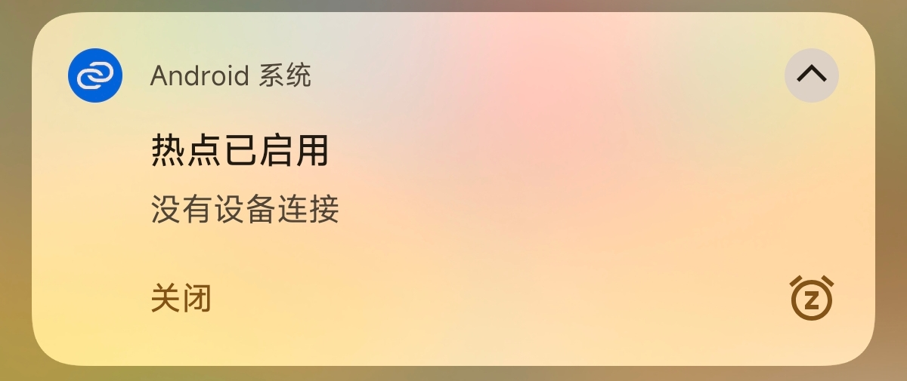
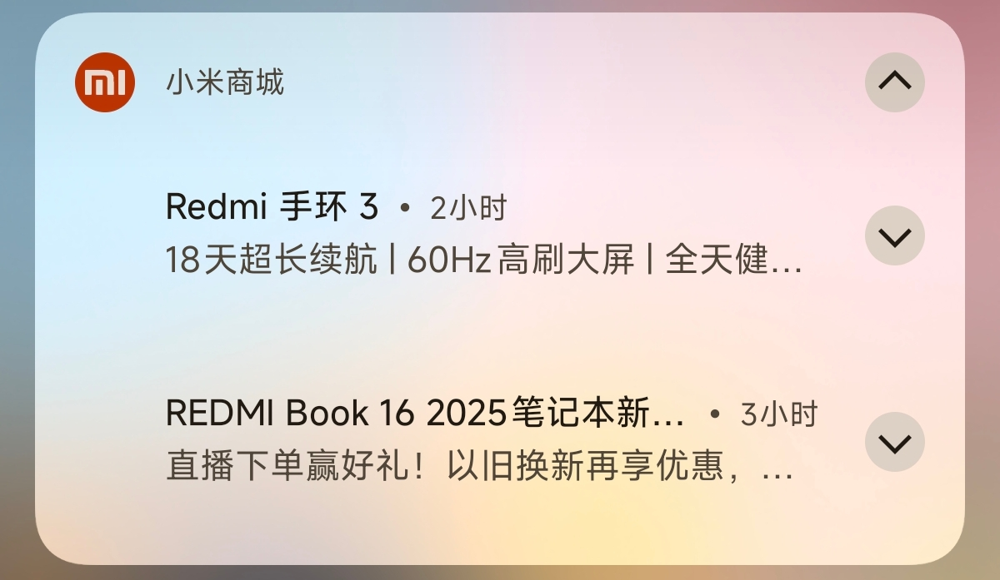
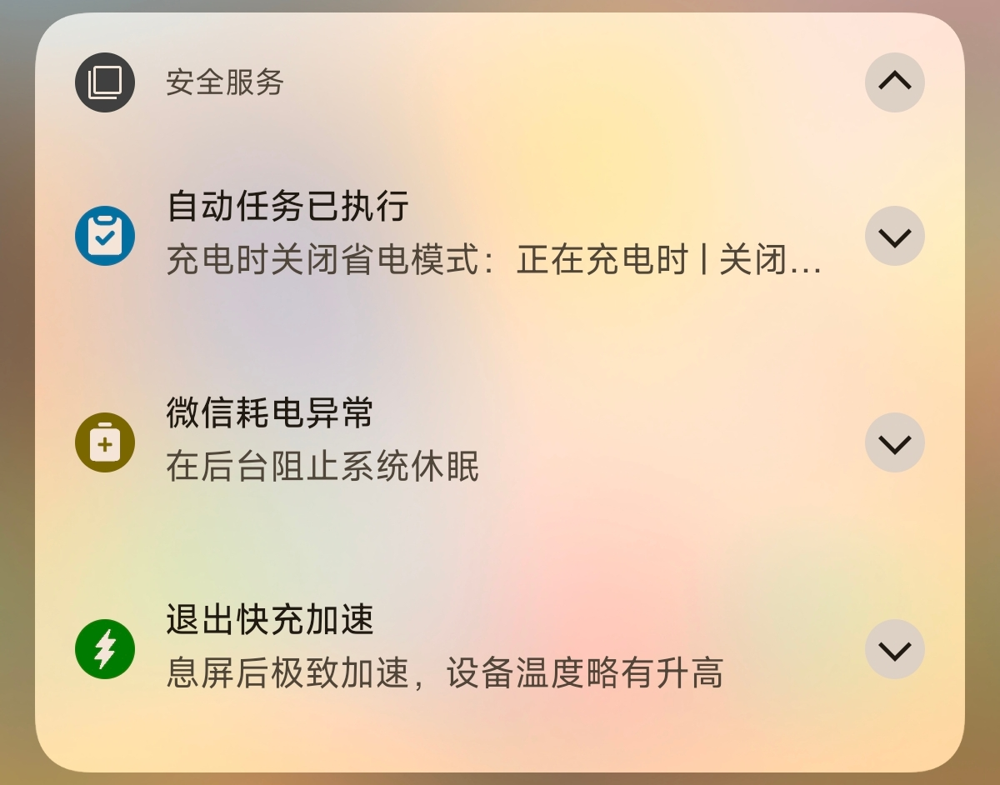
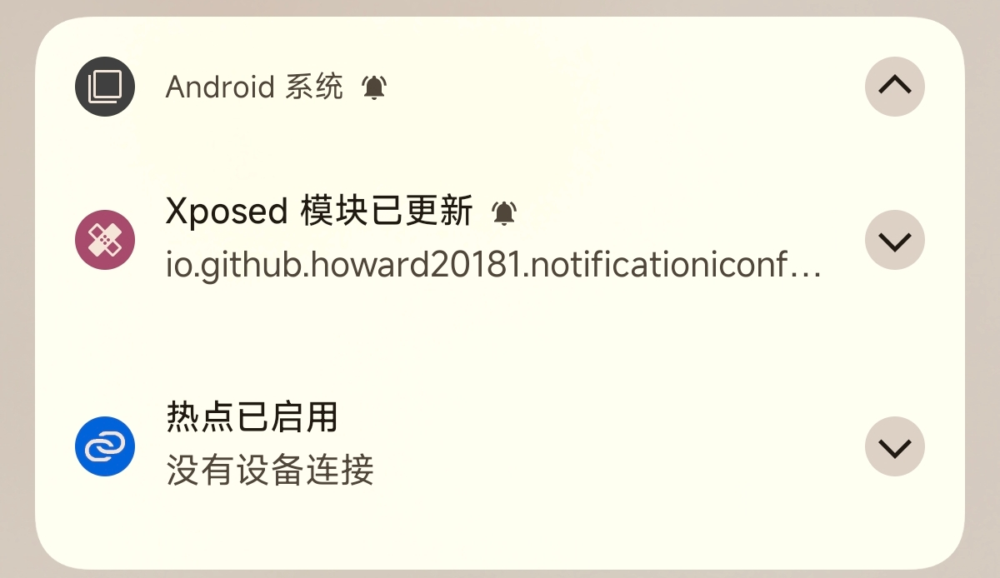

# Notification Icon Fix

[中文](README.zh.md)

A module for AOSP, MIUI and HyperOS. Using an algorithm to convert white notification icons into recognizable icons.

## Supported System

- Android 8.1 ~ AOSP main branch
- HyperOS
- MIUI 10 and above

## Screenshots

|||
|---|---|
|||
|||

## Algorithm Details

1. Determine and reduce oversized icons exceeding the maximum allowed size (512×512 dp)
2. (For MIUI) Detect transparent borders and symmetrically trim icons around the visual center
3. (For MIUI and HyperOS) Determine if the icon has a marketing banner and replace it with a [perfect icon](https://github.com/pzcn/Perfect-Icons-Completion-Project) (need to install it yourself)
4. (For HyperOS) Determine if the icon is a weather icon and replace it with a real-time temperature icon (there is a system bug on HyperOS that causes this to malfunction)
5. Build a full-image luminance histogram, compute the global Otsu threshold, and count the ratio of light vs. dark opaque pixels
6. Collect border pixels from the outermost edge ring, and extract the dominant border color using K-means quantization
7. Calculate the Euclidean distance in Lab color space between each border pixel and the dominant border color to determine whether the icon has a solid single-color border
8. Sample several points along each of the four sides to compute an alpha-weighted representative color per side (skipping border-colored pixels); detect marketing-banner-style edge splits via a "three-sides-similar, one-outlier" rule with three tiers (strict, relaxed, weak); additionally detect corner badges where one corner color clearly differs from the other three
9. If a marketing-banner edge split, corner badge, or low-resolution icon is detected, attempt to substitute the icon by extracting the launcher icon from the application
10. Use CelebiQuantizer (Android 12+) or VariationalKMeansQuantizer to perform K-means quantization and extract the primary theme color of the icon
11. Apply a circular mask to the icon, unconditionally clearing all pixels outside the inscribed circle to eliminate rounded-corner border regions
12. Estimate a per-pixel background color by bilinear interpolation of the four side representative colors; separate foreground from background using a dynamically computed squared-distance threshold; fall back to Otsu luminance thresholding if the foreground pixel count degenerates (too few or too many)
13. Convert foreground pixels to grayscale; if the foreground coverage exceeds 42% of opaque pixels, apply a second Otsu minority-clear pass to remove whichever of the dark or light side is the minority (skipped for gradient-like foregrounds)
14. Tightly crop transparent edges from the final grayscale foreground pixels and output the minimal bounding rectangle with symmetric padding around the visual center
15. Cache the result (icon and primary color) keyed by generation ID in a ConcurrentHashMap backed by SoftReferences for memory-efficient reuse
